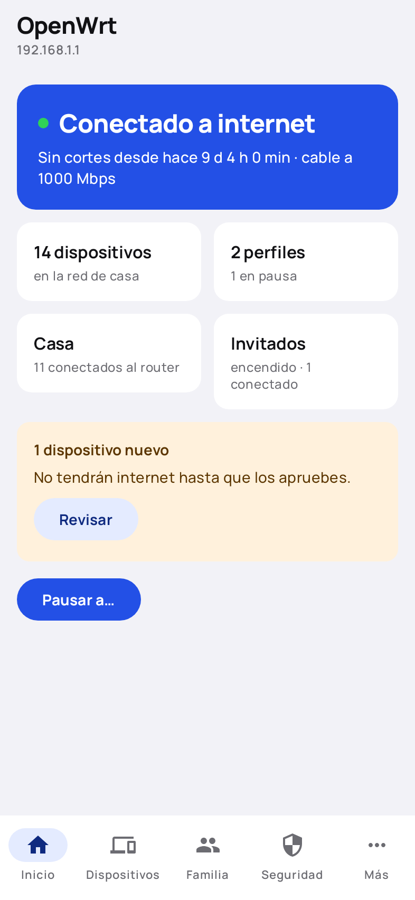
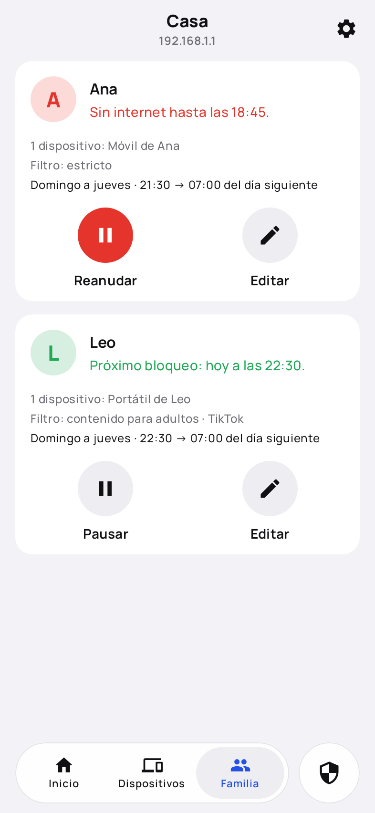
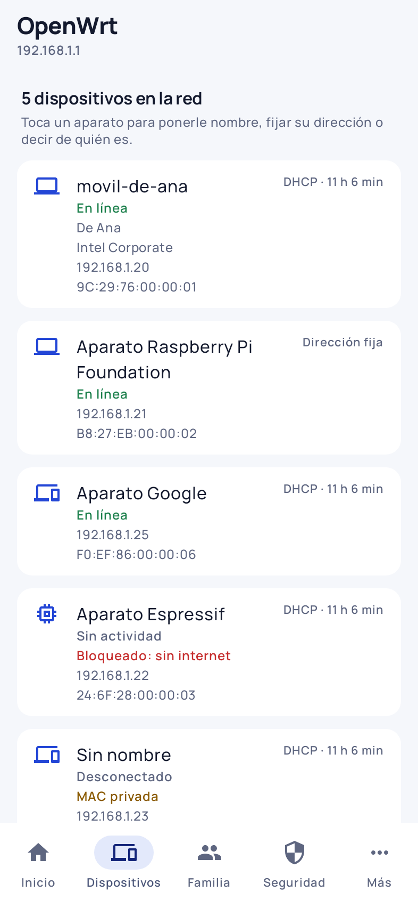
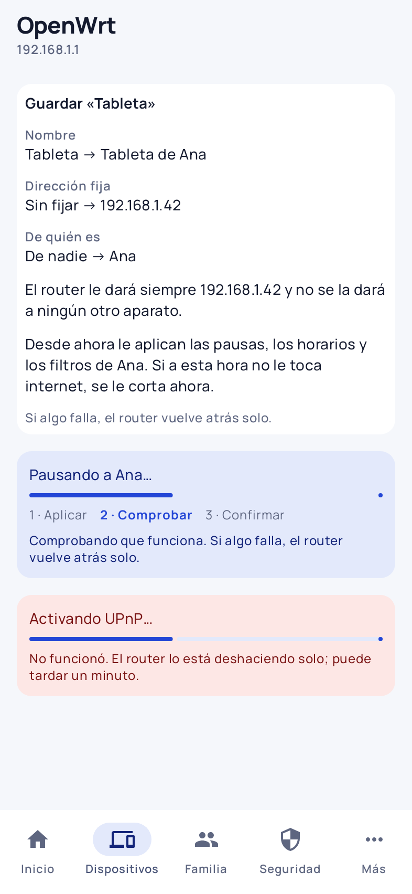
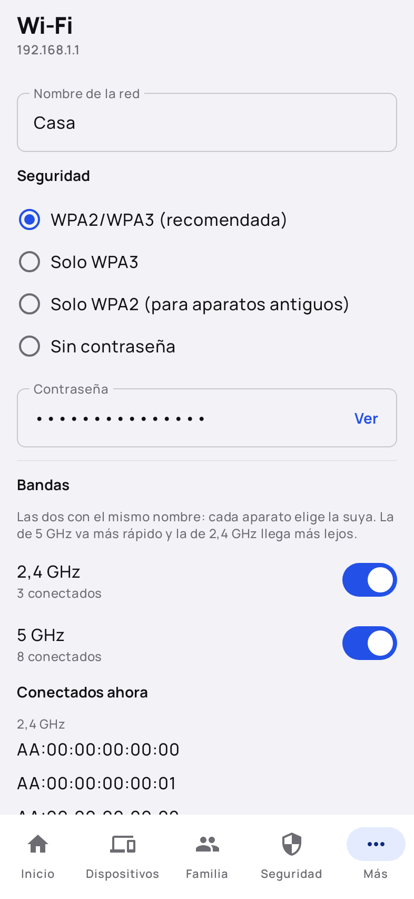
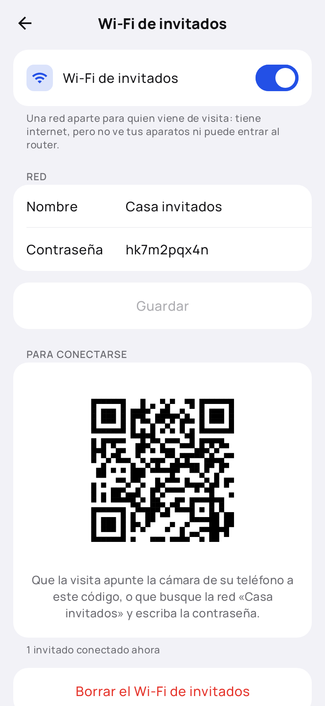

<p align="center">
  
</p>

<h1 align="center">WrtControl</h1>

<p align="center">
  <b>Una app sencilla y segura para el router OpenWrt que ya tienes.</b><br>
  Control parental, dispositivos, Wi-Fi y acceso remoto, explicados por lo que consiguen, no por sus opciones.
</p>

<p align="center">
  <a href="https://github.com/2hotluigi/WrtControl/actions/workflows/ci.yml"></a>
  <a href="https://github.com/2hotluigi/WrtControl/actions/workflows/vm.yml"></a>
  <a href="https://github.com/2hotluigi/WrtControl/releases/latest"></a>
  
  
  <a href="LICENSE"></a>
</p>

<p align="center">
  <a href="https://github.com/2hotluigi/WrtControl/releases/latest">Descargar</a> ·
  <a href="docs/como-funciona.md">Cómo funciona</a> ·
  <a href="ROADMAP.md">Hoja de ruta</a> ·
  <a href="CONTRIBUTING.md">Colaborar</a> ·
  <a href="README.md">English</a>
</p>

---

OpenWrt puede hacer casi de todo, pero LuCI enseña opciones sin contexto. Apps como TP-Link Deco,
Firewalla o UniFi enseñan la red: quién está conectado, quién se queda sin internet esta noche,
cómo entra una visita al Wi-Fi.

**WrtControl lleva esa experiencia a cualquier router con OpenWrt**, sin quitarte el control: usa
la misma API que LuCI, escribe solo lo necesario, lo deja marcado como suyo y cada cambio se
deshace solo si algo sale mal. Para empezar no hay que instalar nada en el router.

<table>
  <tr>
    <td></td>
    <td></td>
    <td></td>
  </tr>
  <tr>
    <td></td>
    <td></td>
    <td></td>
  </tr>
</table>

## Qué hace

- **Tu red de un vistazo.** Si hay internet y desde cuándo, un cable que se cae ("tu cable de
  internet se desconectó 13 veces en 10 minutos y va a 100 Mbps: cámbialo"), cuántos aparatos hay
  conectados y qué pide tu atención.
- **Dispositivos con identidad.** Fabricante por la MAC (sin conexión, sin consultar a nadie),
  nombres que tú eliges (guardados en el router), aviso de MAC privada, dirección fija, de quién
  es y si está en línea. Pausar o bloquear cualquier aparato suelto.
- **Familia.** Un perfil por persona con pausas al momento, horarios con tiempo extra, filtros de
  contenido (adultos, estricto, servicios y sitios bloqueados), búsqueda segura, YouTube
  restringido y protección contra los trucos habituales: DNS cifrado, otros servidores DNS,
  conexiones ya abiertas. Los dispositivos nuevos pueden esperar en cuarentena hasta que los apruebes.
- **Wi-Fi.** Un nombre y una contraseña para todas las bandas, WPA2/WPA3, país, alcance o velocidad
  en vez de anchos de canal, el canal más libre, la potencia, quién está conectado y qué señal le
  llega, y un horario para apagar el Wi-Fi por la noche.
- **Uso de internet.** Cuánto se ha descargado y subido desde que se encendió el router, y la media
  al día, con los contadores del propio router y sin instalar nada.
- **Wi-Fi de invitados.** Una red aparte con código QR: las visitas tienen internet, pero no ven tus
  aparatos ni entran al router.
- **Funciones por resultado.** "Entrar desde fuera de casa" (WireGuard, con el túnel dentro de la
  app: no ocupa la VPN de Android), "Nombre fijo para tu casa" (DNS dinámico), "Juegos y
  videollamadas sin lag" (SQM) y UPnP. La app instala y configura los paquetes por ti.

## Segura por diseño

WrtControl se construye alrededor de una regla: **un cambio nunca te deja sin internet ni sin
router.**

- **Vista previa, aplicar, comprobar, confirmar.** Antes de un cambio con consecuencias, la app
  enseña qué va a cambiar. Después lo aplica con la reversión del propio OpenWrt, comprueba en el
  router que de verdad funciona y solo entonces lo confirma. Si algo falla, o el teléfono pierde
  la conexión a mitad, el router lo deshace solo.
- **Lenguaje llano.** Los errores dicen qué pasó y qué hacer, sin nombres de clase ni códigos.
- **Tus datos se quedan en casa.** La app habla con tu router y con nadie más. Sin cuentas, sin
  nube, sin analíticas. La única excepción es el proveedor de DNS dinámico que elijas, si lo
  activas. La contraseña del router y las claves del acceso remoto van cifradas con el Android
  Keystore.
- **Honesta con la compatibilidad.** Al conectar, la app lee qué puede hacer tu router y explica
  lo que no está disponible en vez de fallar.

## Compatibilidad

| OpenWrt | Soporte | Qué se comprueba |
|---|---|---|
| 24.10, 25.12 y snapshot | Probadas | Todas las pruebas contra un OpenWrt de verdad en una VM, cada noche y en cada PR que toca el router, y las reglas del cortafuegos con su `nft` y `fw4` |
| 22.03 y 23.05 | Puede funcionar | Solo que las reglas que genera la app analizan con su `nft` y `fw4`. La app lo avisa |
| 21.02 y anteriores | No | Sin fw4 (nftables) no hay control parental. La app lo avisa |

Probada también en un router de verdad: un GL.iNet GL-MT6000 (Flint 2) con OpenWrt 25.12, que da
internet a una casa. Seguramente tu router es otro. Si funciona, o si no, [cuéntanoslo](CONTRIBUTING.md):
ahora mismo, los informes de otros routers son la aportación más valiosa.

Hace falta **Android 8.0 o superior** y **OpenWrt con LuCI** (las imágenes estándar lo traen).

## Instalar

1. Descarga el APK firmado de la [última versión](https://github.com/2hotluigi/WrtControl/releases/latest).
2. Ábrelo en el teléfono y permite instalar desde ese origen.
3. Conéctate al Wi-Fi de casa y abre WrtControl: propone la dirección de tu router. Entra con la
   contraseña de `root` del router (la misma que LuCI).

La primera vez, una puesta en marcha corta enseña qué router es, si está protegido, qué puede
hacer la app con él y qué va a cambiar en él (nada, hasta que actives algo).

## Probarla sin router

Un OpenWrt de prueba en tu ordenador, con un comando. Necesita [QEMU](https://www.qemu.org/download/)
(`apt install qemu-system-x86`, `brew install qemu` o `winget install SoftwareFreedomConservancy.QEMU`).

```sh
# Linux y macOS
curl -fsSLO https://raw.githubusercontent.com/2hotluigi/WrtControl/master/tools/vm/demo.sh
sh demo.sh
```

```powershell
# Windows
Invoke-WebRequest https://raw.githubusercontent.com/2hotluigi/WrtControl/master/tools/vm/demo.ps1 -OutFile demo.ps1
powershell -ExecutionPolicy Bypass -File demo.ps1
```

Descarga una vez la imagen oficial x86-64 de la última OpenWrt estable (unos 12 MB, comprobada con
su sha256), le pone a `root` una contraseña aleatoria y la arranca. Después escribe lo que hay que
poner en la app: `10.0.2.2:8080` desde el emulador de Android de ese ordenador, o la IP del
ordenador con `:8080` desde un teléfono en la misma red. El router no toca tu red: su internet
pasa por el ordenador. Ctrl+C lo apaga y `reset` (`-Reset` en Windows) lo deja como nuevo.

No tiene Wi-Fi ni más equipos que el ordenador, y el acceso remoto no llega hasta él; lo demás
(control parental, paquetes, cambios con vuelta atrás) funciona como en un router de verdad.

## Hecha para confiar en ella

- **Cada PR** pasa pruebas unitarias, Android lint, detekt (con ktlint), pruebas de capturas en
  claro y oscuro, y las pruebas del túnel del acceso remoto.
- **OpenWrt de verdad, cada noche.** Las pruebas que tocan el router se ejecutan contra OpenWrt
  24.10, 25.12 y snapshot, con imágenes del Image Builder oficial arrancadas en QEMU y un cliente
  de pruebas con tráfico real: una pausa tiene que cortar incluso una conexión ya abierta.
- **Las reglas del cortafuegos se validan** con `nft -c` y `fw4 check` en OpenWrt de 22.03 a snapshot.
- **Compilación reproducible** de la librería del túnel WireGuard, y versiones firmadas que compila
  la CI a partir de una etiqueta.

## Estado

WrtControl está en desarrollo activo y no ha llegado a la 1.0. Se usa a diario en la red de una
casa. La [hoja de ruta](ROADMAP.md) dice qué está hecho y qué viene. La documentación técnica:
[cómo funciona](docs/como-funciona.md) y [desarrollo](docs/desarrollo.md).

## Colaborar

Los informes de fallos, los informes de routers y los PR son bienvenidos, en español o en inglés.
Ver [CONTRIBUTING.md](CONTRIBUTING.md). Para un problema de seguridad, sigue [SECURITY.md](SECURITY.md)
en vez de abrir un issue público.

## Uso responsable

WrtControl es para routers que son tuyos o que administras. El control parental y el bloqueo de
aparatos afectan a otras personas: úsalos de forma abierta con quien está en tu red y respeta las
leyes de donde vives. La app no lee el tráfico de nadie; decide qué aparatos tienen internet y
qué respuestas de DNS reciben.

## Licencia

Copyright © 2026 Luis Angel Abrego Herrera.

WrtControl es software libre bajo la [GNU General Public License](LICENSE), versión 3 o (a elección
de quien lo use) cualquier versión posterior (`GPL-3.0-or-later`). Quien distribuya una versión
modificada tiene que publicar su código con la misma licencia. Se distribuye sin ninguna garantía.

Las partes de terceros conservan sus licencias: la tipografía Manrope ([SIL Open Font License 1.1](licenses/Manrope-OFL.txt)),
AndroidX, OkHttp, ZXing y gVisor (Apache-2.0), wireguard-go (MIT) y TweetNaCl (dominio público). La
lista de fabricantes por MAC se genera con `tools/update-oui.py` a partir de la lista `manuf` de
Wireshark, que recoge los registros públicos del IEEE.
