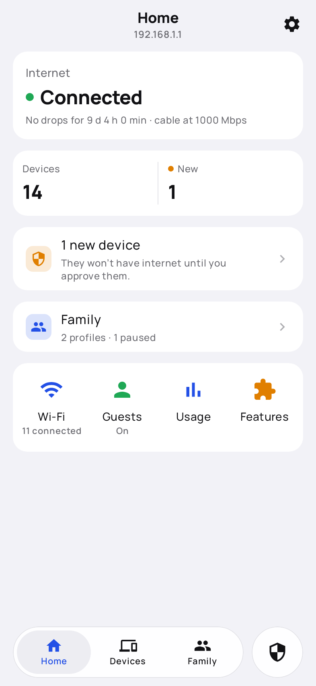
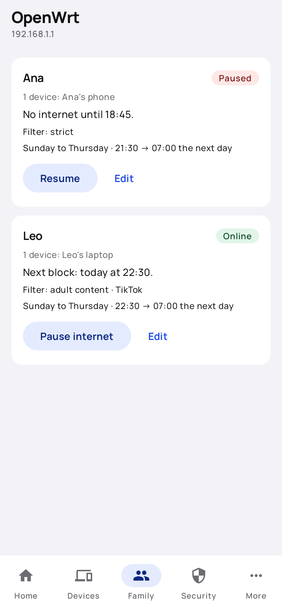
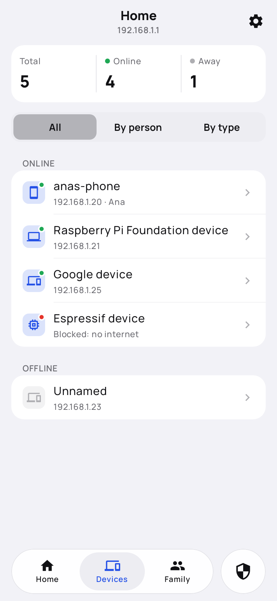
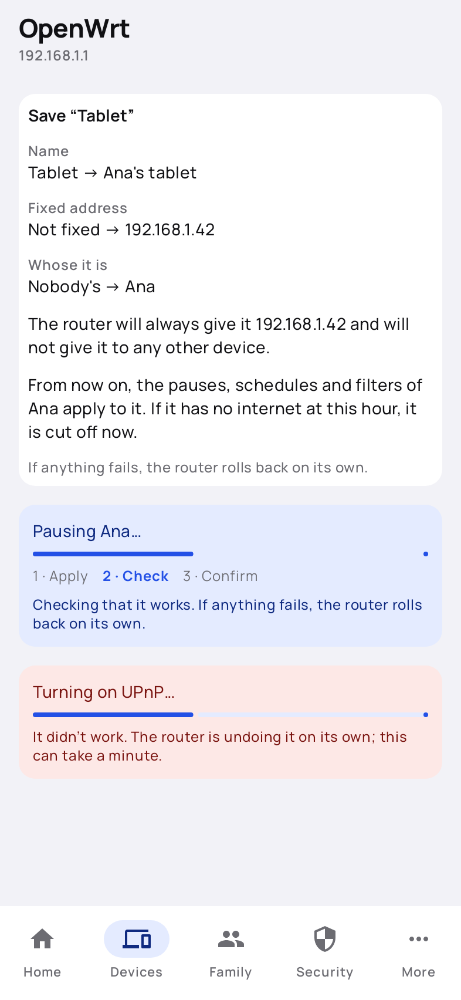
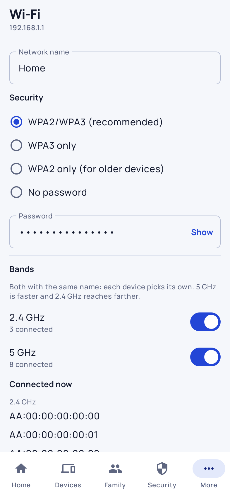
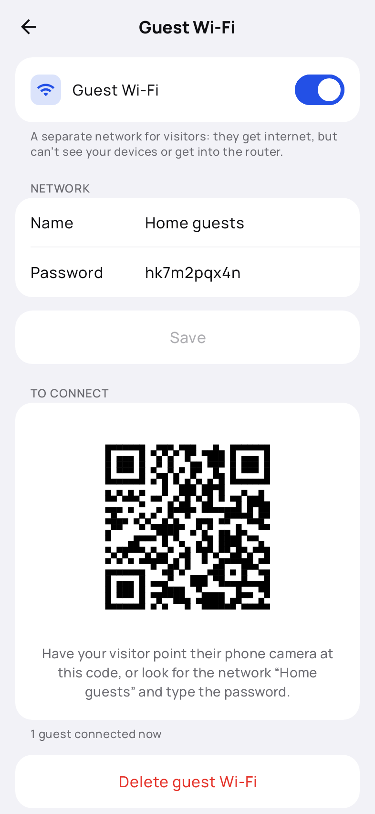

<p align="center">
  
</p>

<h1 align="center">WrtControl</h1>

<p align="center">
  <b>A simple, safe app for the OpenWrt router you already have.</b><br>
  Family controls, devices, Wi-Fi and remote access, explained by what they do, not by their options.
</p>

<p align="center">
  <a href="https://github.com/2hotluigi/WrtControl/actions/workflows/ci.yml"></a>
  <a href="https://github.com/2hotluigi/WrtControl/actions/workflows/vm.yml"></a>
  <a href="https://github.com/2hotluigi/WrtControl/releases/latest"></a>
  
  
  <a href="LICENSE"></a>
</p>

<p align="center">
  <a href="https://github.com/2hotluigi/WrtControl/releases/latest">Download</a> ·
  <a href="docs/como-funciona.md">How it works</a> ·
  <a href="ROADMAP.md">Roadmap</a> ·
  <a href="CONTRIBUTING.md">Contributing</a> ·
  <a href="README.es.md">Español</a>
</p>

---

OpenWrt can do almost anything, but LuCI shows you options without context. Apps like TP-Link
Deco, Firewalla or UniFi show you your network instead: who is online, who gets a break from the
internet tonight, how a guest joins your Wi-Fi.

**WrtControl brings that experience to any router running OpenWrt**, without taking control away
from you: it uses the same API as LuCI, writes only what it needs, marks it as its own, and every
change rolls back on its own if something goes wrong. To get started you don't need to install
anything on the router.

<table>
  <tr>
    <td></td>
    <td></td>
    <td></td>
  </tr>
  <tr>
    <td></td>
    <td></td>
    <td></td>
  </tr>
</table>

## What it does

- **Your network at a glance.** Whether the internet works and since when, a cable that keeps
  dropping ("your internet cable disconnected 13 times in 10 minutes and runs at 100 Mbps:
  replace it"), how many devices are connected, and what needs your attention.
- **Devices with an identity.** Vendor from the MAC address (offline, no lookups), names you
  choose (saved on the router), private-MAC detection, a fixed address, who it belongs to,
  online or not. Pause or block any single device.
- **Family.** A profile per person with instant pauses, schedules with extra time, content filters
  (adult content, strict, blocked services and sites), safe search, restricted YouTube, and
  protection against the usual workarounds: encrypted DNS, other DNS servers, open connections.
  New devices can wait in quarantine until you approve them.
- **Wi-Fi.** One name and password for every band, WPA2/WPA3, country, range or speed instead of
  channel widths, the least crowded channel, transmit power, who is connected and how good their
  signal is, and a schedule to turn the Wi-Fi off at night.
- **Internet usage.** How much has been downloaded and uploaded since the router was turned on, and
  the daily average, read from the router's own counters with nothing to install. With one tap the
  app installs vnStat for a chart of the last 24 hours, 7 days and 30 days, saved once an hour so
  it survives restarts without wearing out the router's storage. Another tap installs nlbwmon to
  see who used the most this month, also in each device's details.
- **Guest Wi-Fi.** A separate network with a QR code: guests get internet, but can't see your
  devices or reach the router.
- **Features by outcome.** "Reach home from outside" (WireGuard, with the tunnel built into the
  app: no Android VPN slot used), "A fixed name for your home" (dynamic DNS), "Games and calls
  without lag" (SQM) and UPnP. The app installs and sets up the packages for you.

## Safe by design

WrtControl is built around one rule: **a change must never leave you without internet or without
your router.**

- **Preview, apply, check, confirm.** Before a change that has consequences, the app shows what
  will change. Then it applies it with OpenWrt's own rollback, checks on the router that it
  really works, and only then confirms it. If anything fails, or your phone loses the
  connection halfway, the router undoes the change on its own.
- **Plain language.** Errors say what happened and what to do, without class names or error
  codes.
- **Your data stays home.** The app talks to your router, nothing else. No accounts, no cloud, no
  analytics. The only exception is the dynamic DNS provider you choose, if you turn that on.
  The router password and remote-access keys are encrypted with the Android Keystore.
- **Honest about compatibility.** On connect, the app reads what your router can do and explains
  any feature that isn't available instead of failing.

## Compatibility

| OpenWrt | Support | What is checked |
|---|---|---|
| 24.10, 25.12 and snapshot | Tested | Every test against a real OpenWrt in a VM, nightly and on each pull request that touches the router code, plus the generated firewall rules with `nft` and `fw4` |
| 22.03 and 23.05 | May work | Only that the generated rules parse with that version's `nft` and `fw4`. The app warns you |
| 21.02 and older | No | Without fw4 (nftables) there are no family controls. The app tells you |

Also tested on real hardware: a GL.iNet GL-MT6000 (Flint 2) running OpenWrt 25.12, serving a real
home. Your router is probably different. If it works, or doesn't, [tell us](CONTRIBUTING.md):
reports from other hardware are the most valuable contribution right now.

You need **Android 8.0 or newer** and **OpenWrt with LuCI** (standard images include it).

## Install

1. Download the signed APK from the [latest release](https://github.com/2hotluigi/WrtControl/releases/latest).
2. Open it on your phone and allow installing from that source.
3. Connect to your home Wi-Fi and open WrtControl: it suggests your router's address. Sign in with
   the router's `root` password (the same as LuCI).

The first time, a short setup shows what router it is, whether it is protected, what the app can
do with it and what will change on it (nothing, until you turn something on).

## Try it without a router

A test OpenWrt on your computer, with one command. It needs [QEMU](https://www.qemu.org/download/)
(`apt install qemu-system-x86`, `brew install qemu` or `winget install SoftwareFreedomConservancy.QEMU`).

```sh
# Linux and macOS
curl -fsSLO https://raw.githubusercontent.com/2hotluigi/WrtControl/master/tools/vm/demo.sh
sh demo.sh
```

```powershell
# Windows
Invoke-WebRequest https://raw.githubusercontent.com/2hotluigi/WrtControl/master/tools/vm/demo.ps1 -OutFile demo.ps1
powershell -ExecutionPolicy Bypass -File demo.ps1
```

It downloads the official x86-64 image of the latest stable OpenWrt once (about 12 MB, checked
against its sha256), gives `root` a random password and boots it. Then it prints what to type in
the app: `10.0.2.2:8080` from the Android emulator on that computer, or the computer's IP with
`:8080` from a phone on the same network. The router leaves your network alone: its internet goes
through the computer. Ctrl+C stops it and `reset` (`-Reset` on Windows) starts over. The script's
messages are in Spanish for now.

It has no Wi-Fi and no devices other than the computer, and remote access can't reach it;
everything else (family controls, packages, changes that roll back) works as on a real router.

## Built to be trusted

- **Every pull request** runs unit tests, Android lint, detekt (with ktlint), screenshot tests in
  light and dark mode, and the remote-access tunnel tests.
- **Real OpenWrt, every night.** The router-facing tests run against OpenWrt 24.10, 25.12 and
  snapshot images built with the official Image Builder and booted in QEMU, with a test client
  generating real traffic: a pause must cut even a connection that is already open.
- **Firewall rules are validated** with `nft -c` and `fw4 check` on OpenWrt 22.03 through snapshot.
- **Reproducible builds** of the WireGuard tunnel library, and signed releases built by CI from a
  tag.

## Status

WrtControl is under active development and has not reached 1.0. It is used daily on one real home
network. The [roadmap](ROADMAP.md) lists what is done and what comes next. The technical
documentation ([how it works](docs/como-funciona.md), [development](docs/desarrollo.md)) is in
Spanish for now.

## Contributing

Bug reports, router reports and pull requests are welcome, in English or Spanish. See
[CONTRIBUTING.md](CONTRIBUTING.md). To report a security issue, follow [SECURITY.md](SECURITY.md)
instead of opening a public issue.

## Responsible use

WrtControl is meant for routers you own or administer. Family controls and device blocking affect
other people: use them openly with the people on your network, and follow the laws where you
live. The app does not read anyone's traffic; it decides which devices get internet and which
DNS answers they receive.

## License

Copyright © 2026 Luis Angel Abrego Herrera.

WrtControl is free software under the [GNU General Public License](LICENSE), version 3 or (at
your option) any later version (`GPL-3.0-or-later`). Anyone who distributes a modified version
must publish its source under the same license. It comes with no warranty.

Third-party parts keep their licenses: the Manrope typeface ([SIL Open Font License 1.1](licenses/Manrope-OFL.txt)),
AndroidX, OkHttp, ZXing and gVisor (Apache-2.0), wireguard-go (MIT) and TweetNaCl (public domain).
The MAC vendor list is generated with `tools/update-oui.py` from Wireshark's `manuf` file, which
collects the IEEE's public registries.
